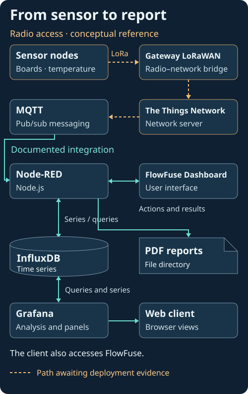

# LoRaWAN IoT Infrastructure

[Español](README.md) · [English](README.en.md)

**Nicolás Nahuel Fontana · Telecommunications Laboratory, UTN Facultad Regional Paraná.**

To study resource management in smart cities, the laboratory brought readings from nine boards, signal quality and device locations into one platform. An operator can inspect an update, retrieve earlier samples and preserve an observation in a report.

The laboratory’s nine LoRaWAN nodes communicate with Gateway A and are managed through The Things Network (TTN). Nicolás Nahuel Fontana developed the software platform that receives readings from TTN over MQTT, processes and stores them, and supports visualization and reporting.

## Processing and storage

Node.js provides the backend runtime. Node-RED receives MQTT events from TTN, writes readings to InfluxDB and updates FlowFuse Dashboard. An incoming event updates the corresponding sensor card. Independently, the dashboard queries InfluxDB once a minute for statistics.

## Dashboards and queries

FlowFuse shows the latest temperature per board and the Cold, Normal and Hot states. Indicators include mean, extremes and spread of temperature, RSSI in dBm and SNR in dB. Operators select a board and time range for historical queries. Grafana queries data stored in InfluxDB to display temperature, geographic location, RSSI and SNR.

## Device reports

From the dashboard, the operator selects a device and application, enters observations and saves the report. The platform keeps the PDF in a directory, with the device and timestamp in its filename.

## Results and future work

The report confirms functional integration of the software tools. Screenshots record the state of the trial. No latency, availability or energy measurements were reported. The author confirmed that RStudio connects to InfluxDB to access stored time series. Predictive analysis and support for larger data volumes are possible extensions. No trained models, predictions or statistical validations have been documented.

## Documentation

- [Architecture and evidence](docs/architecture/README.en.md)
- [Journey of a reading](docs/data-flow/README.en.md)
- [Backend and reports](docs/backend/README.en.md)
- [Time series](docs/database/README.en.md)
- [Panels and queries](docs/dashboards/README.en.md)
- [Results and scope](docs/results/README.en.md)
