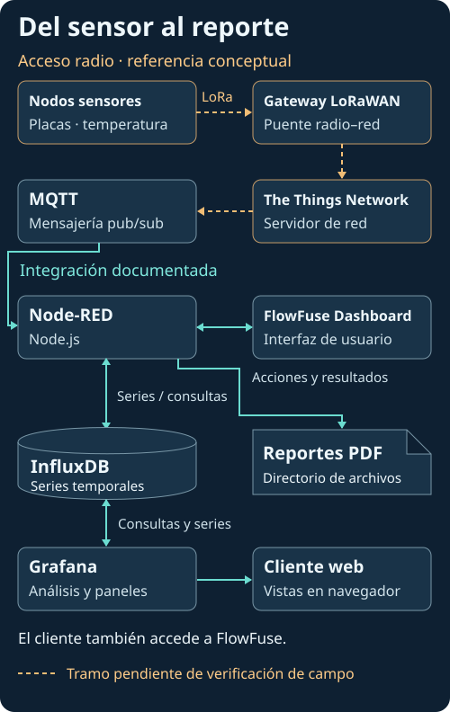

# Infraestructura IoT LoRaWAN

[Español](README.md) · [English](README.en.md)

**Nicolás Nahuel Fontana · Laboratorio de Telecomunicaciones, UTN Facultad Regional Paraná.**

Para estudiar la gestión de recursos en ciudades inteligentes, el laboratorio reunió en una plataforma las lecturas de nueve placas, la calidad de señal y la posición de los dispositivos. El operador puede observar una actualización, recuperar el historial y conservar una observación en un reporte.

Los nueve nodos LoRaWAN del laboratorio se comunican con el Gateway A y están gestionados mediante The Things Network (TTN). Sobre esa infraestructura preexistente, Nicolás Nahuel Fontana desarrolló la plataforma que recibe las lecturas de TTN mediante MQTT, las procesa, las almacena y permite visualizarlas y generar reportes.

## Procesamiento y almacenamiento

Node.js proporciona el entorno de ejecución del backend. Node-RED recibe los eventos MQTT de TTN, escribe las lecturas en InfluxDB y actualiza FlowFuse Dashboard. Una llegada MQTT actualiza la tarjeta del sensor correspondiente; FlowFuse obtiene las estadísticas mediante consultas a InfluxDB cada minuto.

## Dashboards y consultas

FlowFuse muestra la última temperatura por placa y los estados Frío, Normal y Calor. Los indicadores incluyen promedio, extremos y dispersión de temperatura, RSSI en dBm y SNR en dB. El formulario histórico permite elegir placa y período. Grafana consulta las series almacenadas en InfluxDB para visualizar temperatura, ubicación geográfica, RSSI y SNR.

## Reportes por dispositivo

Desde el dashboard, el operador selecciona dispositivo y aplicación, escribe observaciones y guarda el reporte. La plataforma conserva el PDF en un directorio con el dispositivo y la marca temporal en el nombre.

## Resultados y próximos pasos

El informe confirma la interconexión funcional de las herramientas. Las capturas registran el estado del ensayo. No se publicaron mediciones de latencia, disponibilidad o consumo. El autor confirmó la conexión de RStudio con InfluxDB para acceder a las series almacenadas. El análisis predictivo y el manejo de mayores volúmenes de datos son posibles extensiones. No se documentaron modelos entrenados, predicciones ni validaciones estadísticas.

## Documentación

- [Arquitectura y evidencia](docs/architecture/README.md)
- [Recorrido de una lectura](docs/data-flow/README.md)
- [Backend y reportes](docs/backend/README.md)
- [Series temporales](docs/database/README.md)
- [Galería y consultas](docs/dashboards/README.md)
- [Resultados y alcance](docs/results/README.md)
