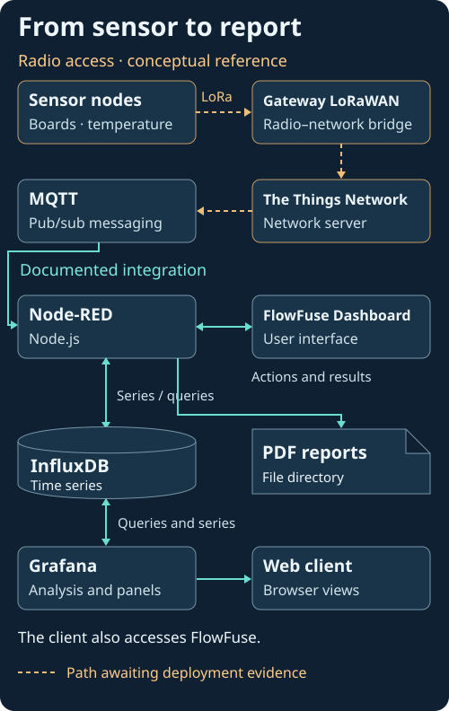

# Architecture and evidence

[Español](README.md) · [English](README.en.md)

Dashed arrows identify the access path in the conceptual reference. The report shows nine boards and incoming MQTT events. Gateway model, backhaul and registration with The Things Network (TTN) still require configuration evidence.

The reference identifies SODAQ boards; an example report includes that name (p. 10). It does not establish a board or sensor model. LoRa denotes the radio physical layer and LoRaWAN the access architecture. The gateway connects radio reception with the network server. MQTT is the downstream messaging interface.

Users access FlowFuse and Grafana in a browser. Blocks denote logical functions. The host allocation and the individual client devices used in tests are unspecified.

Source: Nicolás Nahuel Fontana, *Gestión eficiente de recursos en ciudades inteligentes. Desarrollo de una plataforma IoT*, Telecommunications Laboratory, UTN FR Paraná.
