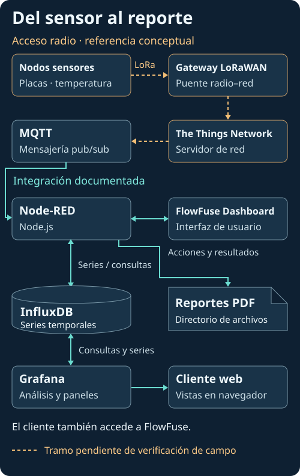

# Arquitectura y evidencia

[Español](README.md) · [English](README.en.md)

Las flechas discontinuas identifican el acceso propuesto en la referencia conceptual. El informe muestra nueve placas y la recepción de eventos MQTT. El modelo del gateway, el enlace de retorno y el alta en The Things Network (TTN) quedan pendientes de evidencia de configuración.

El dibujo conceptual identifica placas SODAQ. Un ejemplo de reporte contiene esa denominación (p. 10); el nombre por sí solo no identifica el modelo ni el sensor empleado. En el esquema de referencia, LoRa describe la capa física de radio y LoRaWAN la arquitectura de acceso. El gateway enlaza la recepción radioeléctrica con el servidor de red. MQTT aparece después de esa etapa como interfaz de mensajería.

El cliente utiliza las interfaces de FlowFuse y Grafana. Los bloques representan funciones lógicas; el informe no especifica en qué máquinas se ejecutan ni documenta el dispositivo cliente de cada ensayo.

Fuente: Nicolás Nahuel Fontana, *Gestión eficiente de recursos en ciudades inteligentes. Desarrollo de una plataforma IoT*, Laboratorio de Telecomunicaciones, UTN FR Paraná.
