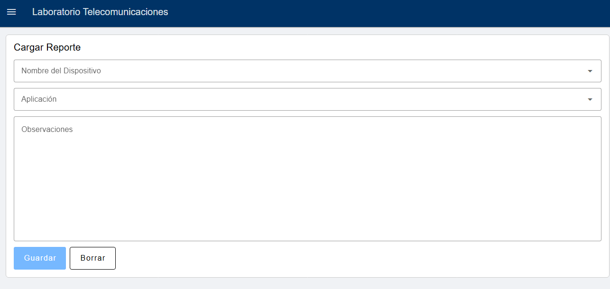

# Backend and reports

[Español](README.md) · [English](README.en.md)

From the dashboard, the operator selects a device and application, enters observations and saves the report. The platform keeps the PDF in a directory, with the device and timestamp in its filename.

Node.js handles connections and event-driven processing (p. 1). The frontend uses @flowfuse/node-red-dashboard (p. 4). Figures 8–11 show the form and output document. “Data-Lake” names the PDF directory. The generation library, rotation policy and filesystem permissions are unspecified.

Source: Nicolás Nahuel Fontana, *Gestión eficiente de recursos en ciudades inteligentes. Desarrollo de una plataforma IoT*, Telecommunications Laboratory, UTN FR Paraná.
