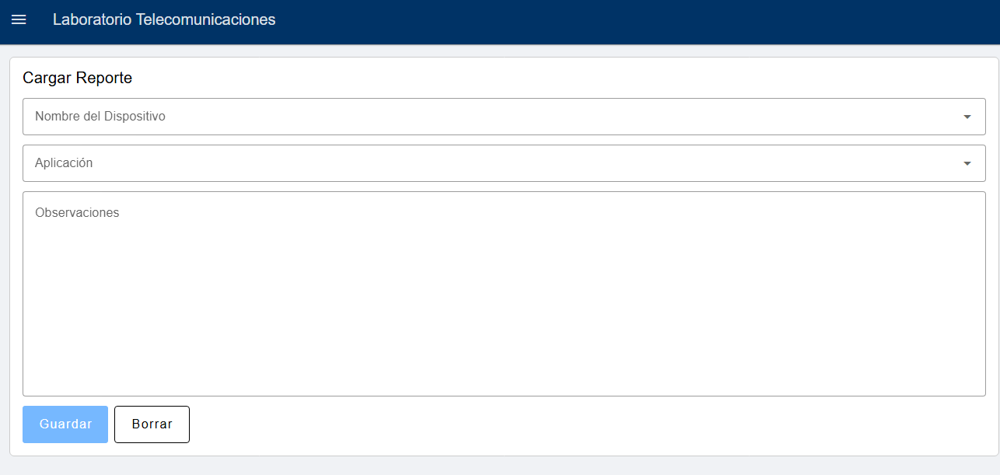

# Backend y reportes

[Español](README.md) · [English](README.en.md)

Desde el dashboard, el operador selecciona dispositivo y aplicación, escribe observaciones y guarda el reporte. La plataforma conserva el PDF en un directorio con el dispositivo y la marca temporal en el nombre.

Node.js participa en la gestión de conexiones y procesamiento basado en eventos (p. 1). El frontend utiliza el módulo @flowfuse/node-red-dashboard (p. 4). Las ilustraciones 8–11 muestran el formulario y el documento generado. «Data-Lake» designa aquí el directorio de PDFs. No se especifican la biblioteca de generación, la política de rotación ni los permisos del sistema de archivos.

Fuente: Nicolás Nahuel Fontana, *Gestión eficiente de recursos en ciudades inteligentes. Desarrollo de una plataforma IoT*, Laboratorio de Telecomunicaciones, UTN FR Paraná.
