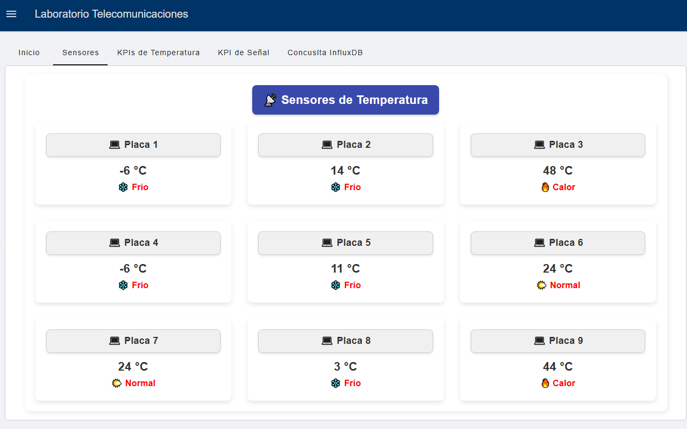
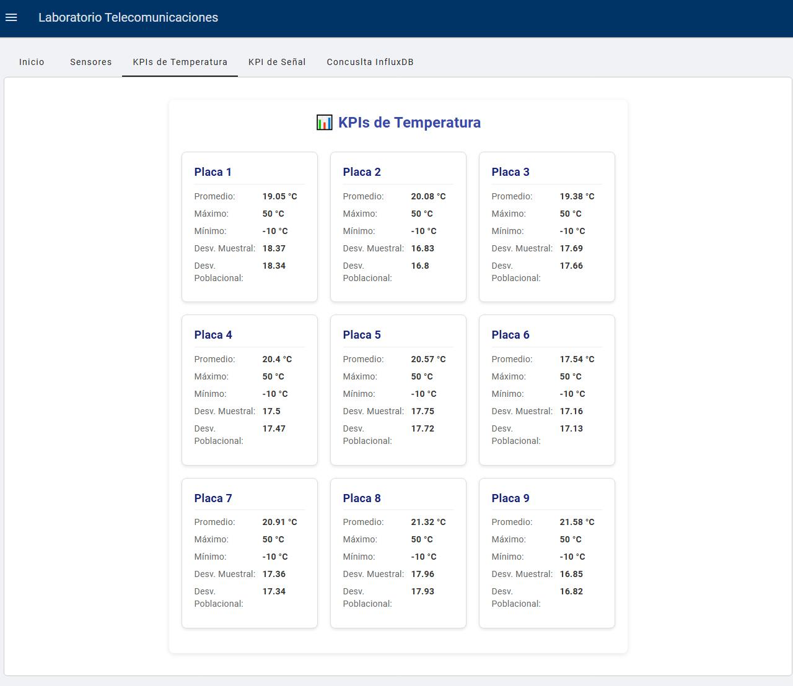
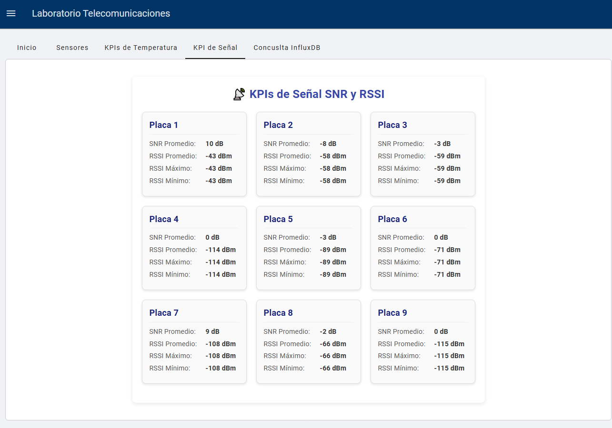
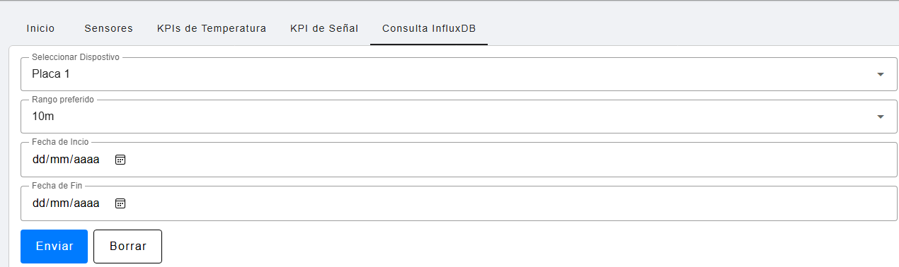
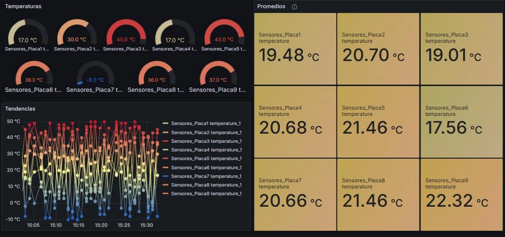
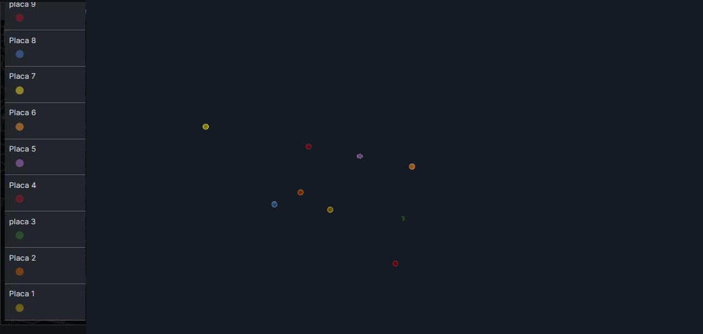
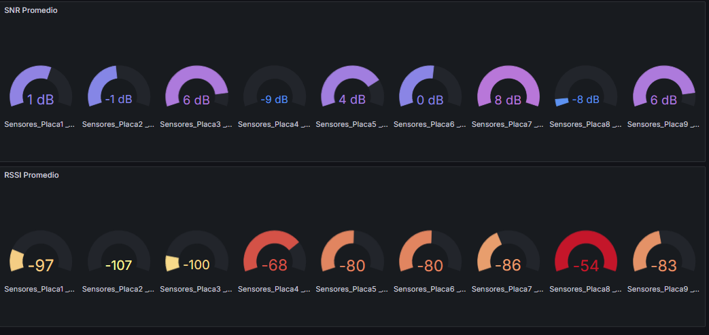

# Panels and queries

[Español](README.md) · [English](README.en.md)

FlowFuse shows the latest temperature per board and the Cold, Normal and Hot states. Indicators include mean, extremes and spread of temperature, RSSI in dBm and SNR in dB. Operators select a board and time range for historical queries. Grafana queries data stored in InfluxDB to display temperature, geographic location, RSSI and SNR.

Historical screenshots from the report. The range notation on p. 5 leaves the handling of decimal values between 30 and 31 °C and out-of-range values open. The cards show observed states; the original flow is needed to reproduce every rule.

Figure 2 · Nine temperature cards with their recorded states.

Figure 3 · Mean, extremes and deviations by board.

Figure 4 · RSSI and SNR summaries by board.

Figure 6 · Query for one board over ten minutes.

Figure 13 · Temperature and trends in Grafana.

Figure 14 · Relative device positions; basemap removed.

Figure 15 · SNR and RSSI panels in Grafana.

Source: Nicolás Nahuel Fontana, *Gestión eficiente de recursos en ciudades inteligentes. Desarrollo de una plataforma IoT*, Telecommunications Laboratory, UTN FR Paraná.
