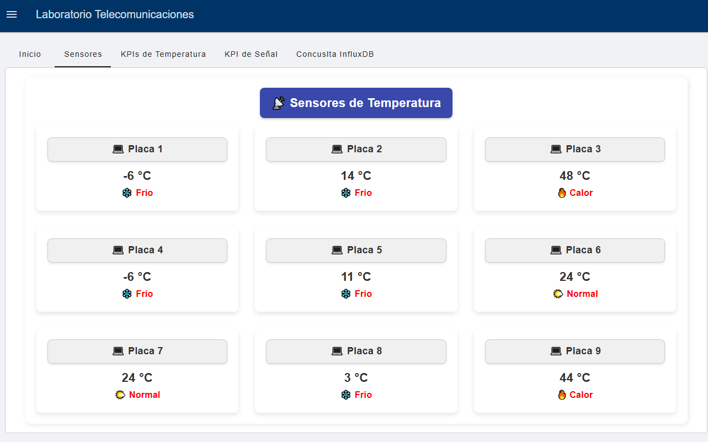
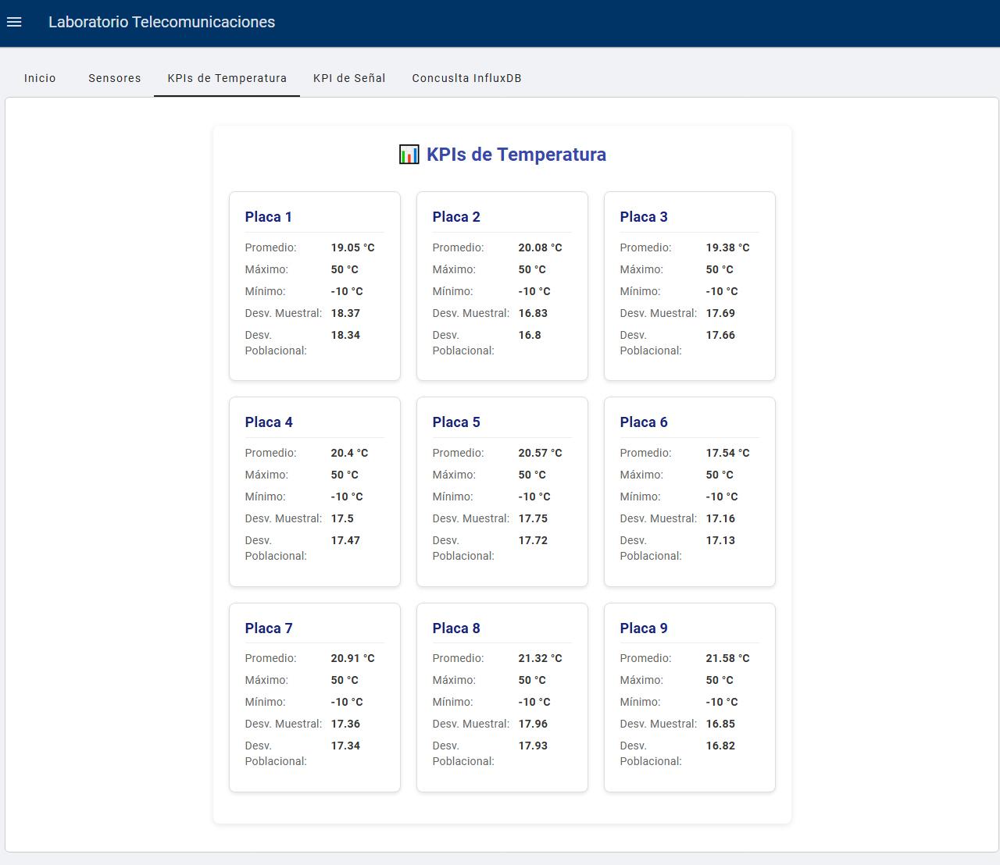
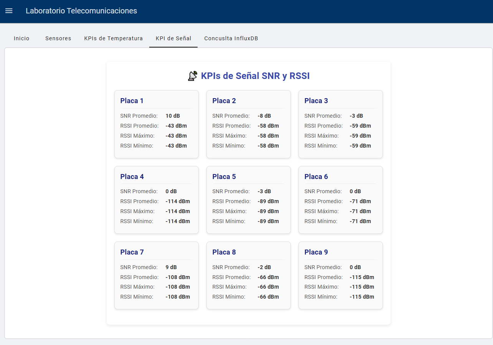
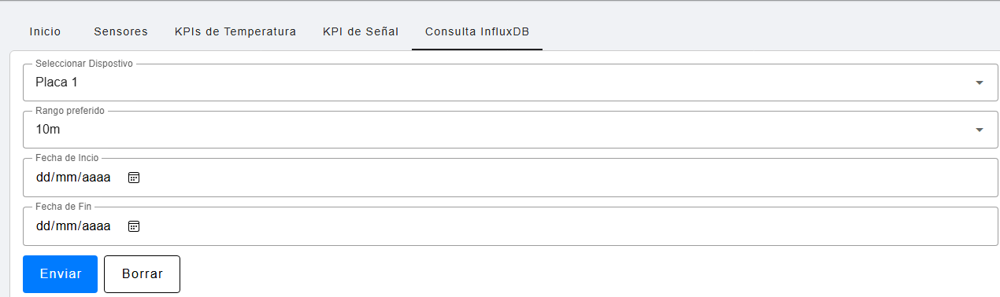
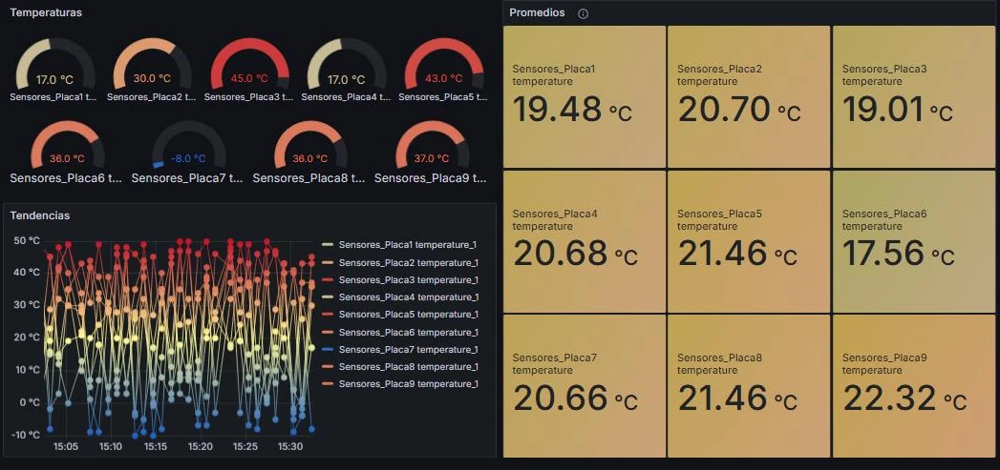
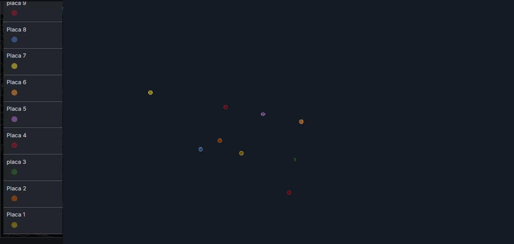
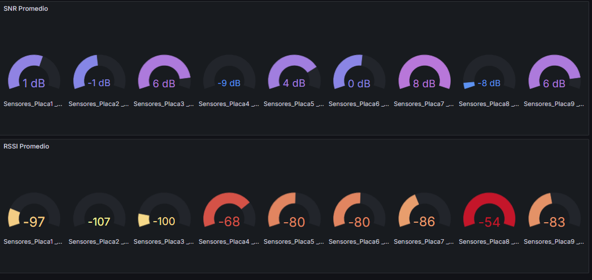

# Galería y consultas

[Español](README.md) · [English](README.en.md)

FlowFuse muestra la última temperatura por placa y los estados Frío, Normal y Calor. Los indicadores incluyen promedio, extremos y dispersión de temperatura, RSSI en dBm y SNR en dB. El formulario histórico permite elegir placa y período. Grafana consulta InfluxDB para mostrar temperaturas, ubicación e indicadores de radio.

Capturas históricas del informe. La notación de los rangos en p. 5 deja sin definir el tratamiento de valores decimales entre 30 y 31 °C y de extremos fuera de rango. Las tarjetas acreditan los estados observados; haría falta el flujo para reproducir todas las reglas.

Ilustración 2 · Nueve tarjetas de temperatura y sus estados.

Ilustración 3 · Media, extremos y desviaciones por placa.

Ilustración 4 · Estadísticos de RSSI y SNR por placa.

Ilustración 6 · Consulta de una placa en una ventana de diez minutos.

Ilustración 13 · Temperaturas y tendencias en Grafana.

Ilustración 14 · Ubicación relativa de las placas; cartografía retirada.

Ilustración 15 · Paneles de SNR y RSSI en Grafana.

Fuente: Nicolás Nahuel Fontana, *Gestión eficiente de recursos en ciudades inteligentes. Desarrollo de una plataforma IoT*, Laboratorio de Telecomunicaciones, UTN FR Paraná.
